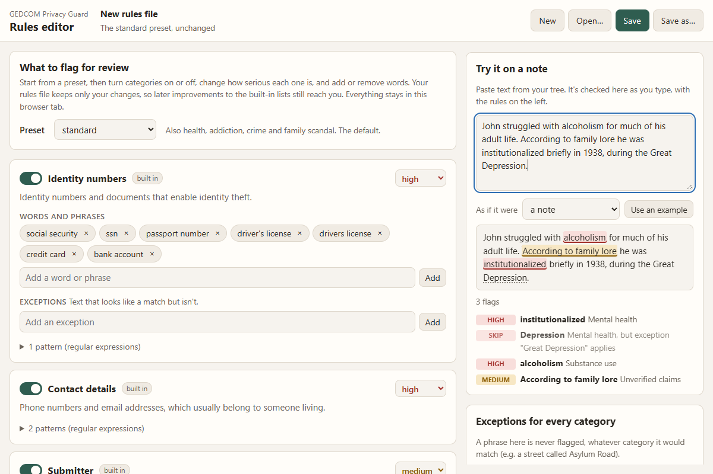

# GEDCOM Privacy Guard

Before you upload a family tree, find the notes that shouldn't go with
it: mental illness, addiction, crime, family rumors, ID numbers, phone
numbers and your own contact details. It works with a GEDCOM export from
any genealogy program (Legacy, RootsMagic, Family Tree Maker, Gramps,
Ancestry…).

It **flags, you decide.** Your review goes in a spreadsheet, and only the
changes you approve are written, to a *new* file. Your original export is
never changed, and nothing leaves your computer.

> **Help wanted:** we've tested exports from Legacy only. If you use
> RootsMagic, Family Tree Maker, Gramps, Ancestry or another program,
> [send a made-up sample or try the 15-minute test](docs/help-wanted.md).



## Install

You need Python 3.10 or later ([python.org](https://www.python.org/downloads/);
on Windows, tick *Add python.exe to PATH*). Then:

```powershell
python -m pip install --user pipx
python -m pipx ensurepath
pipx install gedcom-privacy-guard
```

Open a new terminal afterwards so the command is found.

## Use it

1. **Export** a GEDCOM file from your program
   ([how, for each program](docs/exporting.md)).
2. **Scan** it:

   ```powershell
   gedcom-privacy-guard scan my-tree.ged
   ```

3. **Review** `review.xlsx`. Each row is one hit, with the matched words
   highlighted and enough about the person (dates, parents, spouses, IDs)
   to tell relatives of the same name apart. Pick an action in the first
   column: `keep`, `redact` (replace the note), `rewrite:your wording`, or
   `privatize` (Legacy users only; see [legacy.md](docs/legacy.md)).
4. **Write** the cleaned copy:

   ```powershell
   gedcom-privacy-guard redact my-tree.ged --report review.xlsx
   ```

   Upload `cleaned.ged`. If your tree lives on Ancestry, fix the notes
   there instead; [here's why](docs/exporting.md#trees-that-live-on-a-website).

Try it first on the sample in this repo, `sample_data/sample.ged`.

## Choose how cautious

`--preset open` flags only ID numbers and contact details; `standard`
(the default) adds health, addiction, crime and rumor; `cautious` adds
adoption, illness and addresses. To add your own words or switch
categories off, run `gedcom-privacy-guard editor`, or see
[docs/RULES.md](docs/RULES.md).

## Why your data is safe

It runs only on your computer. It has no server, no account and no
network code, and tests check that on every change by running it with
the network blocked. Turn off Wi-Fi and it works the same.
[More, including where your data *can* still go](docs/safety.md).

## Limits

- **It matches words, not meaning.** "She took her own life" isn't
  flagged; *suicide* is. Skim your notes yourself too.
  [How it decides](docs/how-it-works.md).
- **It never decides for you.** Every hit waits for your choice.
- **It doesn't touch names, dates or places.** A garbled place came from
  the program that made the file.
- **It doesn't yet check for living people.** That's planned.
- A private online tree still shows every note to the people you invite
  ([what a private tree doesn't cover](docs/exporting.md#what-a-private-tree-doesnt-cover)).

## More

[How it works](docs/how-it-works.md) ·
[Why it's safe](docs/safety.md) ·
[Help wanted](docs/help-wanted.md) ·
[Exporting](docs/exporting.md) ·
[Legacy users](docs/legacy.md) ·
[Your own rules](docs/RULES.md) ·
[Architecture](docs/ARCHITECTURE.md) ·
[Roadmap](ROADMAP.md) ·
[Contributing](CONTRIBUTING.md) ·
[Security](SECURITY.md)

MIT licensed. A [Vashon Software](https://vashonsoftware.com) project.
